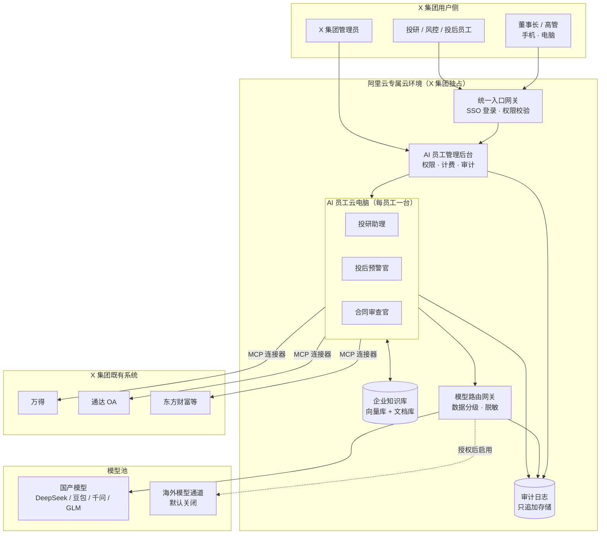

# 《我方私有化部署白皮书》

> 本文为模拟重建的示例文档：原件为项目内部资料、未随资料包公开，此处根据资料包其他文档的上下文重建，结构与方法可参考，具体数字与细节为示意。

## 一页带走（给风控负责人）

| 您关心的问题 | 一句话回答 |
|-|-|
| 数据放在哪？ | 阿里云专属云电脑，账号、密码、控制权在 X 集团手里，等同于您自己买了一台服务器 |
| 别人能看到吗？ | 每个 AI 员工独立云主机，员工之间数据不通；主管看下属产出，董事长看总览 |
| 谁做了什么能查吗？ | 全量审计日志，不可篡改，X 集团管理员可随时导出 |
| 插件会不会有恶意代码？ | 官方 + 第三方双重审计后才上架；审计报告与认证材料将在合规专题 Demo 时提供 |
| 分享链接外面能打开吗？ | 默认不能；外链需管理员开启，并可设有效期、口令、指定人、水印，此部分列入定制开发清单 |
| 用海外模型数据会出境吗？ | 海外通道默认关闭，仅在 X 集团书面授权、且限于非敏感 / 已脱敏数据时启用 |
| 可用性多高？ | 目标 4–5 个 9（以合同 SLA 条款为准） |

---

## 1. 部署架构

### 1.1 总体架构

### 1.2 部署形态

| 形态 | 说明 | 适用档位 |
|-|-|-|
| 专属云电脑（标准） | 阿里云专属资源，X 集团独占，我方负责运维 | 轻档 / 中档 |
| 多套私有化集群 | 按板块拆分集群，跨板块知识库按授权打通 | 重档 |
| 本地机房部署（可选） | 回应"公司里放一个机器可以吗"（S6）：硬件放 X 集团机房，模型调用走专线 | 需单独评估，示意 |

---

## 2. 数据隔离

| 层级 | 隔离方式 | 效果 |
|-|-|-|
| 租户层 | X 集团独占专属云资源，不与其他客户共享计算与存储 | 其他客户无法触达 |
| AI 员工层 | 每个 AI 员工独立云电脑，产出文件、会话、缓存均落在本机 | 员工之间默认不通 |
| 部门层 | 投研 / 风控 / 投后知识库分区，跨部门访问需审批 | 最小必要原则 |
| 板块层（重档） | 金融 / 能源 / 物业 / 创投 / 高科技分集群 | 板块数据边界清晰 |
| 传输层 | 全链路加密传输；连接器使用 X 集团提供的专用账号 | 账号可随时由 X 集团吊销 |
| 存储层 | 静态数据加密；密钥托管方案在部署前与风控负责人确认（示意） | 离开密钥无法读取 |

**数据所有权**：AI 员工产出的报告、看板、知识条目全部归 X 集团所有；合作终止时我方配合全量导出并出具删除确认。

---

## 3. 权限与审计日志

### 3.1 权限模型

| 角色 | 能看什么 | 能做什么 |
|-|-|-|
| 董事长 | 全集团总览、所有 AI 员工产出摘要 | 雇佣 / 解雇 AI 员工、审批外链 |
| 部门主管 | 本部门员工及 AI 员工产出 | 分配任务、配置本部门知识库 |
| 普通员工 | 本人及被授权的 AI 员工 | 下达任务、查看结果 |
| X 集团管理员 | 权限配置、审计日志 | 账号开通 / 吊销、日志导出 |
| 我方运维 | 系统运行指标（CPU、存储、报错） | **默认无业务数据访问权**；排障需 X 集团临时授权，见第 7 节 |

### 3.2 审计日志

- **记录范围**：登录、任务下达、知识库读写、连接器调用、模型调用（含所走通道）、外链生成与访问、权限变更、我方运维操作；
- **防篡改**：只追加存储，按日生成摘要校验值，任何删改可被发现；
- **留存**：默认留存 180 天（示意，可按 X 集团制度调整）；
- **导出**：管理员可按人 / AI 员工 / 时间段一键导出，供内审或外部审计使用。

---

## 4. 模型路由与海外通道

### 4.1 路由原则

| 任务类型 | 示例 | 默认走向 |
|-|-|-|
| 高价值决策 | 投研结论、投委意见、魔鬼代言人审视 | 最强模型（授权后可走海外通道） |
| 中等复杂度 | 合同条款比对、财报要点提炼 | 国产头部模型 |
| 重复劳动 | 格式整理、摘要、翻译 | 国产模型 |

### 4.2 海外通道说明（回应 O8"90 分 vs 10 分"）

会上董事长指出国内外模型存在明显差距。我方已建立经新加坡节点接入海外顶级模型的通道，用于高价值任务。为保证合规，该通道遵循以下规则：

1. **默认关闭**：开通需 X 集团书面授权，并在管理后台留痕；
2. **数据分级前置**：路由网关先对任务内容分级，涉及个人信息、重要数据、未公开交易信息的任务**不走海外通道**；
3. **脱敏处理**：可走海外通道的任务，先去除主体名称、金额等标识信息（示意规则，部署前与风控负责人共同确定）；
4. **跨境合规**：涉及数据出境的场景，按《数据安全法》《个人信息保护法》及相关数据出境规定完成必要评估或备案后方可启用；
5. **可审计**：每一次海外通道调用都写入审计日志，可单独筛查。

---

## 5. 插件安全（回应 O2）

| 环节 | 措施 |
|-|-|
| 来源 | 仅允许官方插件市场与经我方审核的第三方插件；禁止 AI 员工自行从公网安装 |
| 双重审计 | ① 我方官方安全审计（代码扫描 + 权限声明审查）② 第三方安全机构复核 |
| 运行隔离 | 插件在 AI 员工云电脑沙箱内运行，按声明授予最小权限，越权调用被拦截并告警 |
| 版本管理 | 插件版本锁定，更新需重新过审；X 集团可设"仅白名单插件" |
| 材料提供 | 安全审计报告样本与第三方认证 / 测评材料将于合规专题 Demo（T+3~T+7 天）提供给风控负责人 |

---

## 6. 外部分享链接访问控制（回应 O3）

会上该问题当场回答为"需要专门开发"，现列入定制开发清单，方案如下（示意）：

| 控制项 | 默认值 | 可选配置 |
|-|-|-|
| 外链开关 | 关闭（仅登录用户可见） | 管理员按部门开启 |
| 访问对象 | — | 指定手机号 / 邮箱、口令访问 |
| 有效期 | — | 1 天 / 7 天 / 自定义，到期自动失效 |
| 内容保护 | — | 动态水印（访问人 + 时间）、禁止下载 |
| 审批 | — | 敏感知识库内容外链需主管审批 |
| 留痕 | 生成与每次访问均写入审计日志 | 可一键撤回 |

**排期**：建议在中档阶段交付；轻档 POC 期间外链功能保持关闭。

---

## 7. 运维与应急

- **我方访问业务数据的唯一路径**：X 集团管理员发起临时授权（限定范围 + 时长），全程录屏 / 日志，结束自动回收；
- **可用性**：目标 4–5 个 9，具体 SLA 与赔付以合同为准；
- **安全事件**：发现后第一时间通知 X 集团对接人，按《法律合规边界说明》中的响应流程处置。

---

## 8. FAQ（风控负责人常问）

**Q1（O1）：公司信息会不会被别人知道？**
A：数据存放在 X 集团独占的专属云电脑上，控制权在 X 集团；其他客户物理上不共享资源，我方运维默认无业务数据权限，任何访问都在审计日志中可见。

**Q2（O2）：插件会不会被植入恶意代码？**
A：只有经过官方 + 第三方双重审计的插件可以上架，运行在沙箱里并按最小权限授权；X 集团还可开启"仅白名单"。审计报告与认证材料将在合规专题 Demo 时提供。

**Q3（O3）：分享链接外部能不能访问？**
A：默认不能。外链功能列入定制开发清单，上线后需管理员开启，支持指定人、有效期、水印、审批和一键撤回。

**Q4（O6）：你们理论上能不能看我们的数据？**
A：要区分"技术上能否"和"合同 / 法律上是否允许"。技术上我们通过默认无权限 + 临时授权 + 审计日志把可能性压到最低；合同和法律上我们是受托处理方，未经授权访问需承担违约与法律责任。详见《法律合规边界说明》。

**Q5：公司里放一台机器可以吗？**
A：可以评估本地机房部署，但需单独评估硬件、运维和模型调用方式，建议先用专属云跑 POC，再决定是否落地本地。

---

## 相关文档

- [投资集团会议整理与话术库](../投资集团会议整理与话术库.md)
- [痛点 ROI 排序表](../../04_表格CSV/02_痛点ROI排序表.csv)
- [30 天商务节奏表](../../04_表格CSV/03_30天商务节奏表.csv)
- [X 集团合作建议书](./X集团合作建议书.md)
- [私有化部署白皮书](./私有化部署白皮书.md)
- [法律合规边界说明](./法律合规边界说明.md)
