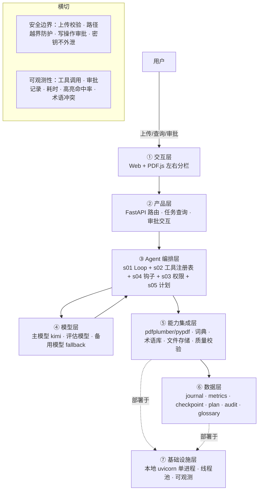

# Agent Harness 升级方案 —— 论文翻译

本文为真实项目材料脱敏版，公司名、人名、链接等已替换，仅供学习交流。

> 依据：`agent-blueprint` 的 `BLUEPRINT.md` 五步 SOP + 六条「可落地」验收标准
> 对象：`tools/论文翻译`
> 目标：从「固定流水线 LLM 应用」升级为「模型驾驶 Harness 的 Agent 产品」
> 原则：**先方案，确认后再生成代码**

---

## 0. 结论摘要

当前 `论文翻译` 是一个**接近生产级的 LLM 工作流产品**（对应蓝图 `s16 工作流运行时`），六条「可落地」标准基本达标；但它**不是严格意义上的 Agent Harness**，核心缺口是：

1. 模型不做决策：`app/services/model.py` 的 `complete()` 只收发文本，**没有 `tools` 参数**，模型不能选择工具。
2. 编排写死在 `app/services/pipeline.py`：`解析 → 切块 → 导读 → 翻译 → 术语 → 落盘` 是固定代码路径。
3. 无权限审批（s03）、无工具钩子（s04）、无工具注册表（s02）、无模型驱动循环（s01）。

升级目标：保留现有高质量业务能力，在编排层引入 **Agent Loop + 工具注册表 + 权限 + 钩子**，让模型负责「规划、选择工具、观察结果、判断何时完成」，Harness 负责「执行、审计、安全边界」。

---

## 1. Step 1 · 需求拆解（作为 Agent Harness 的硬事实）

| 维度 | 结论 | 待确认 |
| --- | --- | --- |
| 目标 | 上传英文论文 → 产出导读 + 全文翻译 + 术语表，并跨篇沉淀术语库 | — |
| 用户 | 本地单用户（研究者/学生），同步为主，大文件异步轮询 | 是否需要多用户/登录 |
| 核心闭环 | 上传 → Agent 规划 → 分块导读/翻译 → 质量校验 → 落盘 → 返回结果 | — |
| 交付物 | `guide_*.md`、`translation_*.md`、`result_*.json`、更新后的 `glossary.json` | — |
| 边界 | 不删除/覆盖用户原始论文；不联网上传论文；不做内容安全外的越权操作 | 远程词典源默认关闭 |
| 约束 | 30 页论文 ≤ 5 分钟；并行 4 路；单块失败不拖垮整篇；模型失败可重试/降级 | 备用模型是否可用 |

**当前已满足的硬事实**：上传类型/大小校验、断点续跑、限流退避、词级高亮、权威词典。**缺口**：模型不能根据中间结果调整策略（例如「术语不一致 → 重译该块」「质量不过关 → 重写导读」）。

---

## 2. Step 2 · 领域建模（Harness 五要素）

### 工具（Tools）

| 能力 | 现状 | 目标形态 |
| --- | --- | --- |
| 读论文 | `app/tools/read_paper.py` 直接调用 | 注册为模型工具 `read_paper` |
| 切块/检视 | `app/services/splitter.py` 直接调用 | 注册为 `inspect_blocks` |
| 导读生成 | `app/services/guide.py` 直接调用 | 注册为 `run_guide_block` |
| 翻译 | `app/services/translator.py` 直接调用 | 注册为 `run_translate_block` / `run_batch_translate` |
| 术语查询/合并 | `app/tools/glossary_io.py` 直接调用 | 注册为 `lookup_glossary` / `update_glossary` |
| 落盘 | `app/tools/save_files.py` 直接调用 | 注册为 `save_guide` / `save_translation` |
| 质量校验 | 缺失 | 新增 `verify_translation` |
| 进度上报 | `app/services/journal.py` 直接调用 | 注册为 `report_status` |

### 知识（Knowledge）

- ✅ 已具备：`knowledge/glossary.json`（334 条）、`knowledge/dictionary/ai.json`、`knowledge/style/翻译风格规范.md`、`knowledge/templates/拆解模板.md`
- 目标：知识按需注入（s07），不全量塞进上下文；术语/风格在翻译前注入，词典用于术语校验。

### 观察（Observation）

- ✅ 已具备：`journal.jsonl`、`metrics.jsonl`、`checkpoint_*.json`
- 目标：增加 `tool_use` / `tool_result` / `plan_state` / `approval` 轨迹，让 Agent 能「看到」每步结果并据此决策。

### 行动（Action）

- ✅ 已具备：模型调用、文件保存、API 路由。
- 目标：行动由模型通过工具调用发起，Harness 统一执行并回传结构化结果。

### 权限（Permissions）

- ⚠️ 现状：只有上传校验 + 路径越界防护 + fail-closed 写入，无审批管道。
- 目标：引入 s03。读/生成类 `allow`；写文件/改术语库 `ask`（本地单用户可默认放行但必须审计）；危险操作默认拒绝。

---

## 3. Step 3 · 组件选型（宁少勿多）

| 组件 | 现状 | 目标 | 理由 |
| --- | --- | --- | --- |
| s01 Agent Loop | ❌ | ✅ 必选 | 模型进入决策环的基础 |
| s02 工具系统 | ❌（函数直调） | ✅ 必选 | 工具注册表 + JSON schema + 统一错误回传 |
| s03 权限系统 | ❌ | ✅ 必选 | 写文件/改术语库需审批与审计 |
| s04 钩子系统 | ❌ | ✅ 必选 | 翻译后自动挂质量校验钩子，不污染主循环 |
| s05 任务规划 | ⚠️（固定顺序） | ✅ 选 | 模型先规划再执行，进度可见 |
| s07 技能加载 | ✅ 半（静态加载） | ✅ 选 | 风格/词典按需注入 |
| s10 任务系统 | ✅（checkpoint/journal） | ✅ 保留 | 断点续跑已有，对齐到任务状态机 |
| s11 后台任务 | ✅（threading） | ✅ 保留 | 长任务不阻塞请求 |
| s15 集成 Harness | ❌ | ✅ 必选 | 单循环统一调度上述机制 |
| s17 目标闭环 | ❌ | ⏸ 二期 | 「翻译何时算完成」自动判断 |
| s06 子 Agent | ❌ | ⏸ 二期 | 分块并行可先用线程，避免 agent 爆炸 |
| s03/s04 之外的 s08/s09/s12/s13/s14/s16 | — | ❌ 不选 | 单用户短会话、无定时、无多团队、编排将改由模型驱动 |

**关键取舍**：分块翻译仍保留 `_map_parallel` 并行实现，但封装成一个工具 `run_batch_translate`，由模型决定「调不调、调哪些块」；不让模型为 20+ 块逐一循环，避免时延与 token 爆炸。

---

## 4. Step 4 · 架构设计

### 4.1 分层架构图（7 层 + 数据流）



**贯穿各层的数据流**：用户上传 → ① 建任务 → ③ 模型按 s05 生成计划 → 循环调用 `read_paper` / `inspect_blocks` → 调 `run_batch_translate` 分批翻译 → s04 钩子触发 `verify_translation` → 不达标则重写/重译 → 调 `save_guide` / `save_translation`（s03 审批）→ `update_glossary` → 完成；全程 tool_use/结果写入 ⑥。

### 4.2 工具清单

| 工具 | 输入 | 输出 | 副作用 | 权限 | 对应现有代码 |
| --- | --- | --- | --- | --- | --- |
| `read_paper` | task_id | 页数、文本/词坐标摘要 | 无 | allow | `app/tools/read_paper.py` |
| `inspect_blocks` | task_id | 块清单（标题/字符数/页码） | 无 | allow | `app/services/splitter.py` |
| `plan_translation` | 块清单、策略 | 计划 JSON | 写任务状态 | allow | 新增 |
| `lookup_glossary` | 术语/domain | 匹配术语 | 无 | allow | `app/tools/glossary_io.py` |
| `run_guide_block` | block_id | 导读 + 术语 | 模型调用 | allow | `app/services/guide.py` |
| `run_batch_translate` | block_ids、术语表 | 批量译文 + 标注 | 模型调用 | allow | `pipeline._map_parallel` + `translator` |
| `verify_translation` | block_id | 质量报告（术语一致/漏译/格式） | 无 | allow | 新增 |
| `save_guide` / `save_translation` | 内容 | 文件路径 | 写 output | ask | `app/tools/save_files.py` |
| `update_glossary` | terms | 新增数 | 写 knowledge | ask | `app/tools/glossary_io.py` |
| `report_status` | status/step | 确认 | 写 journal | allow | `app/services/journal.py` |

### 4.3 系统提示词草案

```text
你是「论文翻译与拆解 Agent」的编排者，负责把上传的英文论文
变成可交付的导读、全文翻译和术语表。

规则：
1. 先规划后执行：先 read_paper + inspect_blocks，生成并写入 plan。
2. 分块处理：用 run_batch_translate 分批翻译；单块失败不中断，记录后继续。
3. 质量把关：翻译后调用 verify_translation；术语不一致/漏译时重写或重译该块。
4. 写操作需审批：save_guide / save_translation / update_glossary 在权限确认后执行。
5. 术语一致性：翻译时使用 lookup_glossary 的译名，冲突交权威词典裁定。
6. 可观测：每阶段用 report_status 更新进度，最终汇报完成与未完成项。

知识目录：knowledge/style/翻译风格规范.md、knowledge/dictionary/、
knowledge/templates/拆解模板.md、knowledge/glossary.json
```

### 4.4 上下文与记忆策略

- **会话内**：只给模型当前块 + 计划 + 术语子集；不把全文塞进上下文（沿用 3500 字符/块）。
- **跨会话**：`glossary.json` 与词典持久化；用户偏好/术语裁定结果可后续进入记忆（s09，二期）。
- **压缩**：暂不需要 s08；若模型上下文不足，先裁工具结果，再摘要历史。

### 4.5 权限与安全边界

- 默认 `allow`：读文件、切块、生成导读/翻译、查询术语（无副作用）。
- 默认 `ask`：写 output、写 glossary（本地单用户可配置为「默认放行 + 审计」）。
- 默认 `deny`：删除原始论文、越界路径、越权目录。
- 保留现有硬约束：扩展名白名单、大小上限、路径 `resolve()` 校验、原子写、`.env` 不外泄。

### 4.6 可观测性设计

- `journal.jsonl` 增加事件：`tool_use`、`tool_result`、`plan_created`、`plan_updated`、`approval`、`verify_failed`。
- `metrics.jsonl` 继续记录：块耗时、总耗时、`highlight_miss`、术语新增、重试次数、审批次数。
- 新增 `audit.jsonl`（或并入 metrics）：谁在何时调用何工具、结果摘要、权限判定。

### 4.7 技术栈与部署形态

- 后端：Python 3.11 / FastAPI / Pydantic / `anthropic` SDK。
- 编排：新增 `backend/app/agent/`（loop、tool_specs、planner、permissions、hooks）。
- 部署：本地 `uvicorn app.main:app --app-dir backend --host 127.0.0.1 --port 8002`，单进程 + `ThreadPoolExecutor`。
- 兼容：保留 `--agent-mode` 开关，默认旧流水线，逐步切换到 Agent 模式。

---

## 5. Step 5 · 代码生成路线（骨架 → 硬化 → 产品化）

> 建议按阶段提交，每个阶段可独立回滚。

### Phase 1 · 骨架（低风险，先让模型进入决策环）

- 新增 `backend/app/agent/__init__.py`
- 新增 `backend/app/agent/loop.py`：通用 Agent Loop（`messages → model → tool_use → execute → append`）
- 新增 `backend/app/agent/tool_specs.py`：注册上述 10 个工具的 JSON schema + handler
- 新增 `backend/app/agent/planner.py`：`plan_translation` 的计划结构
- 修改 `backend/app/api/papers.py`：`_run` 增加 `--agent-mode` 分支，调用 Agent Loop
- 复用：`read_paper.py` / `splitter.py` / `guide.py` / `translator.py` / `glossary_io.py` / `save_files.py` 作为 handler，不改核心业务
- 测试：新增 `backend/tests/test_agent_loop.py`、`test_tool_specs.py`（mock 模型，验证工具分派与结果回传）

### Phase 2 · 硬化（补权限、钩子、fallback、并发锁）

- 新增 `backend/app/agent/permissions.py`：`allow / ask / deny` 判定 + 审计
- 新增 `backend/app/agent/hooks.py`：`PreToolUse`（阻断）/ `PostToolUse`（翻译后挂 `verify_translation`）
- 修改 `backend/app/services/model.py`：增加备用模型 fallback 与调用指标
- 修改 `backend/app/tools/glossary_io.py`：`save_glossary` 加进程内锁/文件锁，消除多任务并发竞态
- 修改 `backend/app/services/journal.py`、`metrics.py`：新增 tool/approval/plan 事件类型
- 测试：`test_permissions.py`、`test_hooks.py`、`test_glossary_concurrency.py`

### Phase 3 · 产品化（目标闭环 + 可选子 Agent + 文档）

- 新增 `backend/app/agent/goal.py`：s17 独立评估器，判断「导读/翻译是否达标、术语是否一致」
- 可选：s06 子 Agent 处理独立章节（仅在块数多、需隔离上下文时启用）
- 前端：结果页增加「Agent 轨迹/审批」轻量展示（可选）
- 文档：更新 `README.md`，补充 Agent 模式启动说明与架构图
- 验收：真实论文端到端跑通，保持 ≤5 分钟目标

**Phase 3 落地状态（2026-08）**：
- ✅ `backend/app/agent/goal.py` 已实现：`structural_check` 结构检查短路 + `evaluate_goal` 独立模型语义/术语复核。
- ✅ `evaluate_goal` 已注册为工具并纳入系统提示词规则 7；`finalize` 结果携带 `goal` 字段，`metrics.jsonl` 写 `goal_check`。
- ✅ 单测通过，真实 `AGENT_MODE=1` 端到端验收跑通（`goal.complete=true`）。
- ✅ 目标闭环增加收敛兜底：连续两次 `complete=false` 或达到 `AGENT_MAX_STEPS` 且已有结果时，强制落盘交付，避免循环失败。
- ⏸ s06 子 Agent、前端「Agent 轨迹/审批」展示按可选项暂缓，待产品侧确认。

---

## 6. 验收标准（沿用蓝图六条）

| 标准 | 升级后如何满足 |
| --- | --- |
| 可运行 | 一条命令启动，`--agent-mode` 开关可切换 |
| 可容错 | 单块失败继续、限流退避、fallback 模型、断点续跑 |
| 可观测 | journal/metrics/audit 记录 tool_use、plan、approval、verify |
| 可测试 | loop/tool 分派、权限、钩子、并发均有 mock 单测 |
| 可部署 | 本地单进程 + 明确端口 8002 + 启动文档 |
| 可度量 | 总耗时、块耗时、重试次数、审批次数、高亮命中率、术语冲突数 |

---

## 7. 风险与回滚

| 风险 | 影响 | 应对 |
| --- | --- | --- |
| Agent 循环增加时延/token 成本 | 超 5 分钟目标 | 分块翻译保持批量工具，不让模型逐块循环；设 `MAX_AGENT_STEPS` 上限 |
| 模型误调危险工具 | 写错目录/覆盖 | s03 默认 deny + 路径越界防护 + 写操作 ask |
| 工具 schema 过宽导致分派失败 | 翻译中断 | 保持工具数量 ≤10，schema 严格，错误统一回传 |
| 多任务并发写术语库 | 丢失更新 | 文件锁 + 合并前重读（Phase 2） |
| 旧流水线回归 | 存量任务异常 | `--agent-mode` 默认关闭，灰度切换 |

---

## 8. 附录：当前关键文件映射

- `backend/app/main.py` — FastAPI 入口
- `backend/app/api/papers.py` — 上传/后台线程入口（改造点）
- `backend/app/api/tasks.py` — 任务/结果/重试
- `backend/app/services/pipeline.py` — 固定流水线（将被 Agent Loop 调度）
- `backend/app/services/model.py` — 模型调用（需加 fallback + 工具调用）
- `backend/app/services/splitter.py` — 切块/高亮匹配
- `backend/app/services/guide.py` / `translator.py` — 导读/翻译生成
- `backend/app/tools/read_paper.py` / `glossary_io.py` / `save_files.py` — 工具 handler 复用
- `knowledge/` — 术语库、词典、风格、模板
