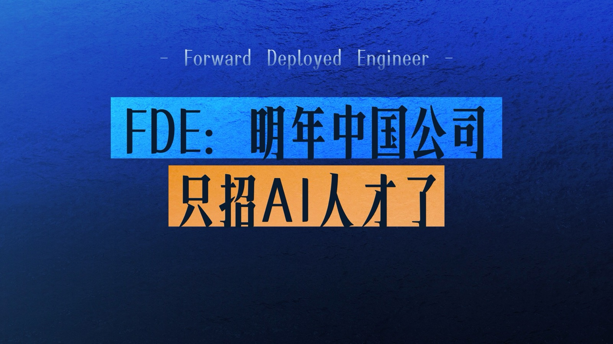
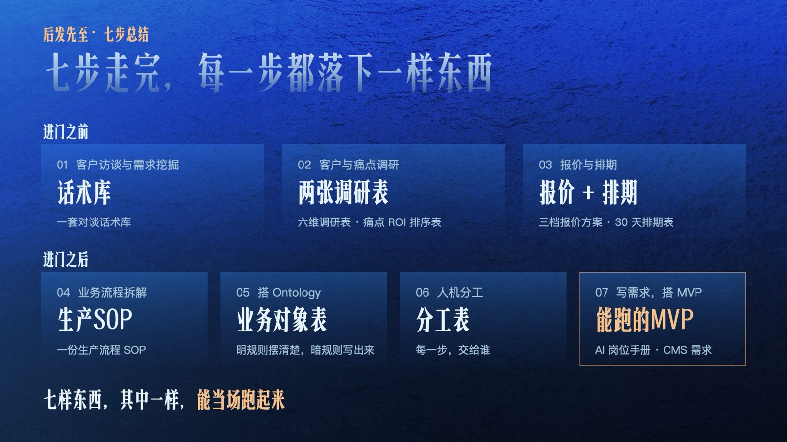
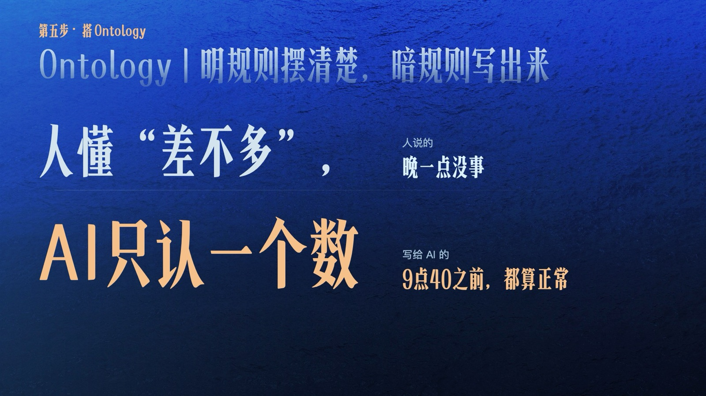

<div align="center">



# FDE 入场七步 · 资料包

**2026 上海分享会《FDE：明年中国公司只招 AI 人才了》配套资料**

一份逐字稿 · 两个真实项目 · 七样能打开给面试官看的东西


[逐字稿](#-逐字稿) · [七步全景](#-七步全景) · [怎么用](#-怎么用) · [目录](#-目录) · [说明](#-说明)

</div>

---

## 💡 这是什么

现场屏幕上那些看不清的表格和文档，都在这里了。

它们来自同学们在**真实公司里做的真实项目**：一家投资集团的 AI 合作，从第一次开会一直谈到报价；一家 AI 英语学习公司，从一部中文剧本做成一门能上线的课。公司名、人名、地点、内部链接都已替换，**方法、结构、表格原样保留**。

> 懂，不值钱了。能打开给人看的东西，才值钱。


| 泥沙俱下 | 化虚为实 | 后发先至 |
|:--|:--|:--|
| 889 家公司各招各的，没标准就没门槛，谁先进去谁说了算 | 虚的是嘴上说"我懂"，实的是能打开给人看的项目 | 外行没关系，掌握一套规则，就能先到 |

---

## 📖 逐字稿

**[`00_分享会逐字稿.md`](./00_分享会逐字稿.md)** — 全场 60 多页，每段都标了对应的画面。没来现场的同学，从这里开始。

---

## 🧭 七步全景



| | 步骤 | 落下来的东西 | 看哪份 |
|:--:|:--|:--|:--|
| **进门之前** | **01** 客户访谈与需求挖掘 | 关键人物速查 · 一套对谈话术库 | [会议整理与话术库](./01_进门之前_投资集团案例/投资集团会议整理与话术库.md) |
| | **02** 客户与痛点调研 | 六维调研表 · 痛点 ROI 排序表 | 同上 · [六维调研](./04_表格CSV/01_六维投资人调研模型.csv) · [痛点排序](./04_表格CSV/02_痛点ROI排序表.csv) |
| | **03** 报价与排期 | 三档报价方案 · 30 天排期表 | 同上 · [30 天节奏](./04_表格CSV/03_30天商务节奏表.csv) |
| **进门之后** | **04** 业务流程拆解 | 一份生产流程 SOP（18 步） | [课程制作上线全过程](./02_进门之后_英语学习产品案例/课程制作上线全过程_18步.md) |
| | **05** 搭 Ontology | 业务对象表：明规则摆清楚，暗规则写出来 | [CMS 需求文档](./02_进门之后_英语学习产品案例/CMS需求文档.md) · [剧本规则手册](./02_进门之后_英语学习产品案例/剧本语言与知识点要求_含编剧Agent_Prompt.md) |
| | **06** 人机分工 | 分工表：每一步，交给谁 | [课程制作上线全过程](./02_进门之后_英语学习产品案例/课程制作上线全过程_18步.md) |
| | **07** 写需求，搭 MVP | AI 岗位手册 · 写给 AI 的需求文档 · 能跑的 MVP | [Agent Harness 升级方案](./03_写给AI的需求文档/Agent_Harness升级方案_论文翻译示例.md) · [AI 岗位手册](./04_表格CSV/07_AI岗位手册.csv) |

<details>
<summary><b>🔍 Ontology 那一段没听懂？点开看</b></summary>
<br>



公司规定 9 点半打卡，可大家都知道，晚个十分钟没事。这个"没事"，人心里有数，AI 心里没数——它只会照 9 点半算，9 点 31 就给你记迟到。

**Ontology 干两件事：明规则，摆清楚；暗规则，写出来。** 而且要写成 AI 能执行的样子：不是"晚一点没事"，是"9 点 40 之前，都算正常"。

具体怎么写，看 [CMS 需求文档](./02_进门之后_英语学习产品案例/CMS需求文档.md) 里的状态流转，和 [暗规则写进 CMS](./04_表格CSV/06_暗规则写进CMS.csv) 这张表。

</details>

---

## 🚀 怎么用

最省事的用法：**把逐字稿和对应的文档一起丢给 AI**，让它带着你，拿你自己的行业走一遍。

```text
这是一场关于 FDE 的分享会逐字稿，和其中第二步用到的调研表、痛点排序表。
请按这套方法，帮我给【你所在的行业 / 你认识的一家公司】：
1. 列一份六维调研表：每一维查什么、去哪查；
2. 列出这家公司最可能的 5 个痛点，按"有多疼 / 现在怎么凑合 / 有没有现成方案"排个优先级。
```

七步走完，你手里就有七样东西。哪天面试官问："你做过什么项目，能打开给我看看吗？"——你打开的，不是一份 PRD，是这七样东西。其中一样，能当场跑起来。

---

## 📂 目录

```text
FDE-Shanghai-2026-Share
├── 00_分享会逐字稿.md                      全场逐字稿
├── 01_进门之前_投资集团案例
│   └── 投资集团会议整理与话术库.md          第 1–3 步：开会、调研、报价
├── 02_进门之后_英语学习产品案例
│   ├── 课程制作上线全过程_18步.md           第 4、6 步：拆流程、人机分工
│   ├── CMS需求文档.md                      第 5、7 步：Ontology、写需求
│   └── 剧本语言与知识点要求_含编剧Agent_Prompt.md   规则手册 + 写给 AI 的 Prompt
├── 03_写给AI的需求文档
│   └── Agent_Harness升级方案_论文翻译示例.md   第 7 步：需求拆解 → 代码生成路线
└── 04_表格CSV                              分享会上屏的 7 张表，Excel / WPS / 飞书都能打开
```

---

## 📌 说明

- 所有材料均为真实项目材料的**脱敏版**，仅供学习交流，请勿用于商业用途。
- 文中报价、数字只是当时项目里的估算口径，不代表任何公司的正式报价。
- 案例里的公司、人物均已替换为代称，如有雷同，纯属巧合。

<div align="center">
<br>

**胡泊** · 且曼北京校区校长 · 抖音 AI 区精选创作者

觉得有用，点个 ⭐ Star，下次更新第一时间看到。

</div>
